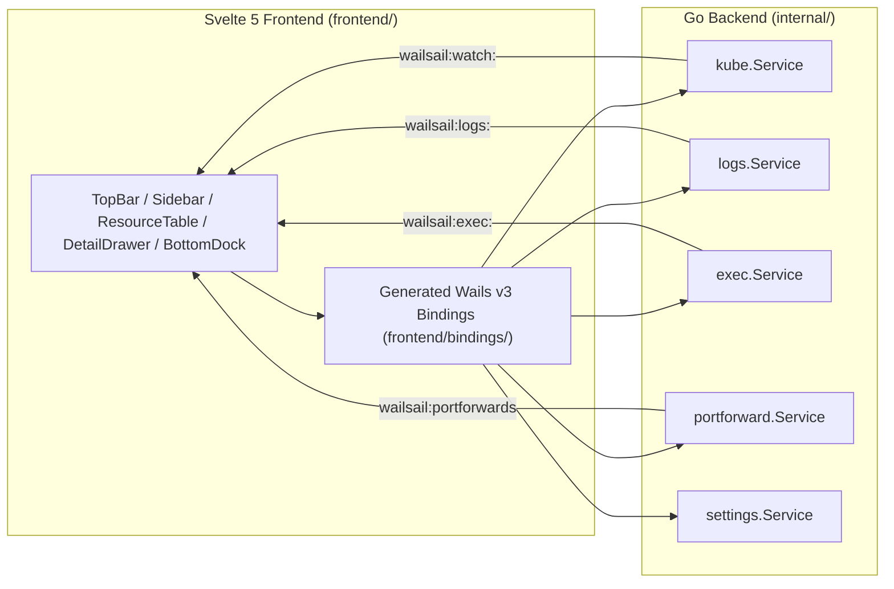

# AGENTS.md — `wailsail`: Kubernetes Desktop Client (Go + Wails v3)

## 1. Mission & Scope
**`wailsail`** is an original Kubernetes desktop client written in Go with **Wails v3**
(`github.com/wailsapp/wails/v3`) and a **Svelte 5 + TypeScript + Vite** frontend.

### Engineering Rules
- **Wails v3 APIs only.** No Wails v2 APIs (`wails.Run`, `Bind: []interface{}{}`, `wails/v2/pkg/runtime`).
  Use `application.New`, `application.NewService`, `app.Event.Emit`, and generated TypeScript bindings in `frontend/bindings/`.
- **Kubernetes access via `k8s.io/client-go`** (typed, dynamic, discovery, WebSocket/SPDY exec, and SPDY port-forward).
- **Cancellable streams & event topics.** Long-lived streams are keyed by caller- or backend-generated IDs via `internal/stream.Registry` and pushed via Wails events:
  - Resource watches: `wailsail:watch:<id>`
  - Container logs: `wailsail:logs:<id>`
  - Exec TTY sessions: `wailsail:exec:<id>`
  - Port-forward list updates: `wailsail:portforwards`
- **Icons & build metadata.** Keep root `icon.png` as the canonical source icon; sync changes to `build/appicon.png`, `build/ios/icon.png`, and `frontend/public/icon.png`, and regenerate platform icons via `wails3 task common:generate:icons`.
- **Verification.** Keep `go build ./...`, `go vet ./...`, `go test ./...`, `npm run check`, and `npm run build` in `frontend/` green.

---

## 2. Workspace Layout
```text
.
├── AGENTS.md               # Project rules, architecture, and service contracts
├── CHANGELOG.md            # Release history and notable changes
├── README.md               # User-facing documentation
├── Taskfile.yml            # Wails v3 root build/dev/package task runner
├── go.mod / go.sum         # Go module `wailsail`
├── icon.png                # Canonical app icon (embedded in main.go & frontend)
├── main.go                 # Wails v3 app entry point, embeds frontend/dist & icon.png
├── internal/               # Go backend packages
│   ├── exec/               # ExecService: interactive container shell (WebSocket/SPDY TTY)
│   ├── kube/               # Manager + KubeService: contexts, discovery, watch, YAML, apply/delete/scale/restart
│   ├── logs/               # LogService: container log streaming with 100ms batching
│   ├── portforward/        # PortForwardService: local TCP -> Pod/Service port forwarding
│   ├── settings/           # SettingsService: atomic JSON config at <UserConfigDir>/wailsail/settings.json
│   └── stream/             # Cancellable stream Registry and Emitter type
├── frontend/               # Svelte 5 + TypeScript + Vite UI
│   ├── index.html          # HTML shell with /icon.png favicon
│   ├── public/             # Static assets (icon.png, style.css)
│   ├── bindings/           # Auto-generated Wails v3 TS bindings (do not hand-edit)
│   └── src/
│       ├── App.svelte
│       ├── lib/            # api.ts, format.ts, resources.ts, store.svelte.ts
│       └── components/     # TopBar, Sidebar, ResourceTable, DetailDrawer, BottomDock, LogViewer, TerminalView, modals
├── build/                  # Wails v3 config.yml, icons, desktop/installer packaging templates
├── bin/                    # Compiled binaries (gitignored)
└── logs/                   # Runtime logs directory (gitignored)
```

---

## 3. Architecture & Implemented Service APIs



### `internal/kube`
- `Manager` loads `$KUBECONFIG` / `~/.kube/config` via `clientcmd.NewDefaultClientConfigLoadingRules()` and caches per-context `Clients` (typed, dynamic, cached discovery, RESTMapper). `SetKubeconfigPaths` switches to user-configured files/directories (`~`, `$VAR`, `%VAR%` expanded; directories scanned non-recursively for valid kubeconfigs; `$KUBECONFIG` entries appended with lower precedence; empty list = standard rules). `Reset` re-scans directories.
- `Service`:
  - `Contexts() ([]ContextInfo, error)`
  - `Reload()`
  - `SetKubeconfigPaths(paths []string)` / `KubeconfigFiles() []string`
  - `DefaultNamespace(contextName string) (string, error)`
  - `ServerVersion(contextName string) (string, error)`
  - `Namespaces(contextName string) ([]string, error)`
  - `APIResources(contextName string) ([]ResourceType, error)`
  - `Watch(contextName string, ref ResourceRef, namespace, streamID string) (string, error)` — requests `meta.k8s.io/v1` `Table` rows, coalesces updates every 150ms, relists on `410 Gone`, emits `WatchEvent` (`reset`, `columns`, `upserts`, `deletes`, `error`)
  - `StopWatch(streamID string)`
  - `GetDetail(contextName string, ref ResourceRef, namespace, name string) (ObjectDetail, error)` — returns structured object, YAML without `managedFields`, related Kubernetes events, and live container CPU/memory usage (`ContainerMetrics` via `metrics.k8s.io/v1beta1`)
  - `PodMetrics(contextName, namespace string) (map[string]ContainerMetrics, error)` — returns live container CPU/memory usage for pods in a namespace (or all namespaces)
  - `ObjectEvents(contextName, kind, namespace, name string) ([]EventInfo, error)`
  - `GetYAML(contextName string, ref ResourceRef, namespace, name string) (string, error)`
  - `Apply(contextName, manifest, defaultNamespace string) ([]ApplyResult, error)` — multi-document YAML/JSON + `List` expansion via Server-Side Apply (`fieldManager: "wailsail"`)
  - `Delete(contextName string, ref ResourceRef, namespace, name string) error`
  - `Scale(contextName string, ref ResourceRef, namespace, name string, replicas int32) error`
  - `Restart(contextName string, ref ResourceRef, namespace, name string) error`
  - `PodContainers(contextName, namespace, pod string) ([]ContainerInfo, error)`

### `internal/logs`
- `Service`: `Start(contextName, namespace, pod string, opts Options, streamID string) (string, error)` and `Stop(streamID string)`.
- Batches log lines every 100ms and emits `Event` (`lines`, `ended`, `error`) on `wailsail:logs:<id>`.

### `internal/exec`
- `Service`: `Start(contextName, namespace, pod, container string, command []string, cols, rows uint16, sessionID string) (string, error)`, `Write(sessionID, data string) error`, `Resize(sessionID string, cols, rows uint16) error`, and `Close(sessionID string)`.
- Uses WebSocket with SPDY fallback (`remotecommand.NewFallbackExecutor`) and emits base64-encoded chunks (`data`, `exited`, `error`) on `wailsail:exec:<id>`.

### `internal/portforward`
- `Service`: `List() []Forward`, `ServicePorts(contextName, namespace, name string) ([]kube.ContainerPort, error)`, `Start(req Request) (Forward, error)`, `Stop(id string)`.
- Resolves `Pod` or `Service` (via selector + ready pod + named/numeric `targetPort`) and listens on `127.0.0.1:<localPort>`, emitting updated `[]Forward` on `wailsail:portforwards`.

### `internal/settings`
- `Service`: `Get() (Settings, error)`, `Save(st Settings) error` with atomic temp-file writes to `<UserConfigDir>/wailsail/settings.json`, and `DefaultKubeconfig() string`.
- `Settings` includes `scale` (UI zoom percent: 50/75/100/125/150, default 100, applied via `Window.SetZoom` or CSS `zoom` for `<100%`), `kubeconfigPaths` (default `[<home>/.kube/config]`, applied at startup in `main.go`), `columnOrders`, and `columnWidths` (persisted per-resource table column ordering and widths).

### Frontend conventions
- Font: bundled Google Sans Flex (`frontend/public/fonts/`, OFL) via `--sans`.
- Spacing follows an 8-point grid using `--space-1`..`--space-6` (4/8/16/24/32/40px) from `frontend/public/style.css`.
- Resource table shows wide columns by default with static (`table-layout: fixed`), draggable (reorderable), and resizable columns; cell text is single-line clipped (`text-overflow: clip`).
- Container resource meters in `DetailDrawer` and `ResourceTable` use rounded tracks (`--track`) with a vertical request marker (white `--mark-request` at `request/limit`, or yellow `--warn` at `25%` when no limit is set), threshold bar colors (`<80%` green, `80%–94.99%` yellow, `>=95%` red), and plain-text fallback when neither request nor limit is defined.
- Hover tooltips (`title`) are used only on clickable `<button>` elements (describing the button's action) and container resource progress bars (`Used / Request / Limit`).

---

## 4. Verification
From the repository root:
1. Frontend check & build: `cd frontend && npm run check && npm run build`
2. Go build, vet & tests: `go build ./... && go vet ./... && go test ./...`
3. Full desktop binary build: `wails3 build` (outputs `./bin/wailsail`)
