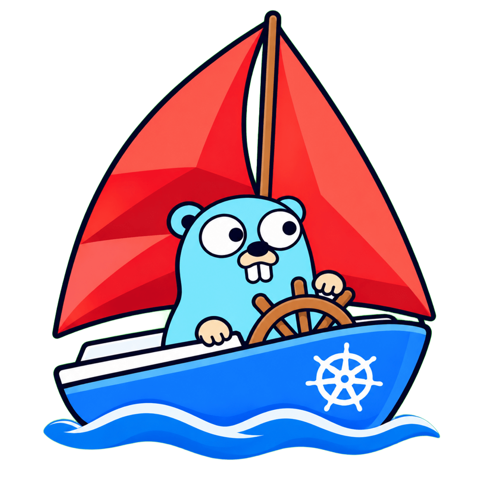

<p align="center">
  
</p>

<h1 align="center">wailsail</h1>

<p align="center">
  <strong>An original Kubernetes desktop client written in Go with Wails v3</strong><br />
  <em>Sail as far as you can, Captain! These nodes are in your control!</em>
</p>

---

## Features

- **Contexts, Namespaces & Custom Kubeconfigs** — Loads merged kubeconfigs from custom files and scanned folders (defaulting to `~/.kube/config` plus `$KUBECONFIG`), switches clusters quickly, remembers per-context namespaces, and displays cluster server versions.
- **Discovery-Driven Resource Browser** — Automatically discovers core and custom API resources (`CRDs`), groups them cleanly in a resizable sidebar (with popular acronyms like `PVC`, `PDB`, `HPA`, `CRD`), and lets you pin favorite resource types.
- **Live Watch Tables** — Streams server-side `meta.k8s.io/v1` `Table` views with 150ms batched updates, automatic relist on `410 Gone`, wide columns by default, draggable & resizable columns (persisted across restarts), live Pod CPU & memory usage meters, and one-click `Jump to Owner` navigation.
- **Resource Overview, Events & YAML Inspector** — Inspect structured metadata (with quick copy buttons and expandable labels/annotations), workload/service/node specifications, live container CPU & memory progress bars (`metrics.k8s.io/v1beta1`), conditions, and object-related Kubernetes events, or switch to the YAML tab with optional **Neat** cleanup (`kubectl-neat`-style state stripping), copy, inline editing (`Tab` indentation, `Ctrl/Cmd+S` Server-Side Apply), and scale, rollout restart, or delete actions.
- **Live Container Logs** — Follow pod/init/ephemeral container logs with tail selection, timestamps, previous container logs, pause/resume, and real-time line filtering.
- **Interactive Exec Terminal** — Open container shells inside a bottom dock powered by `@xterm/xterm` with auto-fit resizing and automatic `bash` / `sh` detection.
- **Port Forwarding** — Forward Pod or Service ports to `127.0.0.1` (auto-assigning local ports when `0`) with live status tracking and one-click stop.
- **Persistent Preferences, Scaling & Themes** — Light, Dark, and System themes, UI screen scale (`50%`–`150%`), custom kubeconfig paths, column orders/widths, and per-context state persisted to `<UserConfigDir>/wailsail/settings.json`.

---

## Tech Stack & Architecture

- **Backend (`internal/`, `main.go`)**: Go + [Wails v3](https://v3.wails.io/) + [`k8s.io/client-go`](https://github.com/kubernetes/client-go)
  - `kube.Service` — kubeconfig client caching, resource discovery, live `Table` watches, YAML get/apply/delete/scale/restart
  - `logs.Service` — batched pod log streaming
  - `exec.Service` — WebSocket/SPDY interactive TTY exec sessions
  - `portforward.Service` — SPDY port-forwarding for Pods and Services
  - `settings.Service` — atomic JSON preferences storage
- **Frontend (`frontend/`)**: Svelte 5 (runes) + TypeScript + Vite + `@xterm/xterm` + generated Wails v3 bindings

---

## Prerequisites

- **Go** `1.26+`
- **Node.js** & **npm**
- **Wails v3 CLI** (`v3.0.0`):
  ```bash
  go install github.com/wailsapp/wails/v3/cmd/wails3@v3.0.0
  ```
- **Linux desktop libraries** (GTK4 & WebKitGTK 6.0):
  - Ubuntu / Debian: `libgtk-4-dev libwebkitgtk-6.0-dev`
  - Arch Linux: `gtk4 webkitgtk-6.0`
  - Fedora: `gtk4-devel webkitgtk6.0-devel`
- A valid Kubernetes config via `$KUBECONFIG` or `~/.kube/config`

---

## Development & Build

### Run in Development Mode
```bash
wails3 dev
```

### Build Production Binary
```bash
wails3 build
```
The compiled binary is written to `bin/wailsail` (or `bin/wailsail.exe` on Windows).

### Run Checks & Tests
```bash
# Backend build, vet, and unit tests
go build ./...
go vet ./...
go test ./...

# Frontend typecheck and production bundle
cd frontend
npm install
npm run check
npm run build
```

> **Live Cluster Smoke Test (optional):**
> ```bash
> WAILSAIL_LIVE_CONTEXT=<your-context> go test ./internal/kube -run TestLiveCluster -v
> ```

---

## Project Structure

```text
.
├── main.go                 # Wails v3 entry point (embeds frontend/dist & icon.png)
├── icon.png                # Canonical application icon
├── Taskfile.yml            # Wails v3 build/package tasks
├── internal/
│   ├── exec/               # Container TTY exec service
│   ├── kube/               # Kubeconfig manager, table parser, watcher, CRUD service
│   ├── logs/               # Container log streaming service
│   ├── portforward/        # Pod/Service port-forward service
│   ├── settings/           # User preferences persistence
│   └── stream/             # Cancellable stream registry & emitter
├── frontend/
│   ├── index.html          # App shell with favicon
│   ├── public/             # Static assets (icon.png, style.css)
│   ├── bindings/           # Generated Wails v3 TypeScript bindings
│   └── src/
│       ├── App.svelte
│       ├── lib/            # API wrapper, formatters, resource grouping, Svelte store
│       └── components/     # UI components (table, drawer, dock, logs, terminal, modals)
└── build/                  # Wails v3 platform configs, icons, and packaging assets
```

---

## Keyboard Shortcuts

- `Esc` — Close open confirmation dialogs, modals, or the detail drawer
- `Ctrl/Cmd + S` — Apply edits while editing resource YAML in the detail drawer
- `Tab` — Insert 2 spaces while editing resource YAML

---

## Releasing

See [RELEASE.md](RELEASE.md) for the full list of version placeholders and release checklist.
